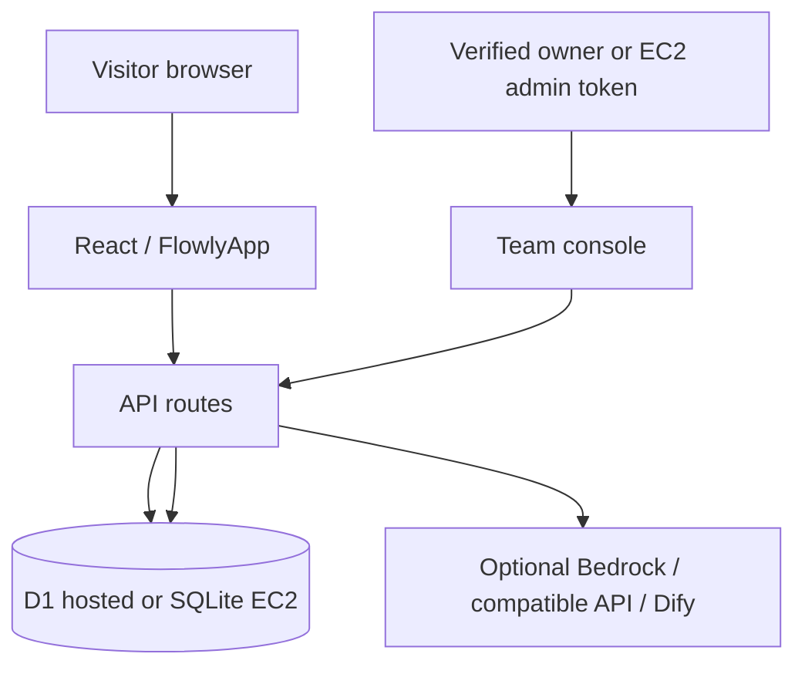

# PROJECT_COMPLETE_AUDIT — Flowly

**Audit date:** 27 October 2026  
**Audit method:** Static inspection of the current repository source, routes, components, schemas, migrations, deployment files, test file and existing project documentation. No website UI, API behavior, data record or deployment setting was changed for this audit.  
**Repository state reviewed:** commit `482618e` (the source state after the latest readability and GitHub-handoff updates).

---

## 1. Executive summary

Flowly is implemented as a **bilingual AI, software and automation services website** with a lead-intake and consultation-request workflow. It is not a SaaS product portal, ERP product, customer account system or public administration portal.

The current product boundary is clear in code:

1. A visitor discovers services, industries and Flowly’s delivery approach.
2. A visitor can use guided discovery, submit requirements, request a provisional consultation or contact the team.
3. Requests and provisional time slots are saved in D1 (hosted) or SQLite (EC2).
4. A visitor can track only their own request using reference + submitted email.
5. An authorized owner can review requests and update their status in `/team`.
6. The bottom-right assistant gives service guidance from the Flowly catalog and can call an optional configured AI provider.

The project already contains a substantial marketing and intake frontend, a small backend API surface, three database entities and a portable EC2 distribution. The main work remaining is **operational integration and productization**, not rebuilding the current website:

- select and configure a real AI provider, mail, calendar and CRM;
- assign operating owners, data retention, support and backup procedures;
- introduce multi-user authentication and RBAC only if more than one staff member will work in the team console;
- add a customer portal/dashboard only if Flowly chooses to sell ongoing client access rather than scoped engagements;
- add CI/CD, monitoring, proper migration execution, test coverage and legal/commercial inputs before public launch.

---

## 2. Audited project topology

| Layer | Actual implementation | Evidence |
|---|---|---|
| Frontend | React 19 application using Vinext/Next-style routing | `app/`, `components/`, `package.json` |
| Hosted runtime | Cloudflare Workers/Vinext with D1 binding `DB` | `.openai/hosting.json`, `db/index.ts` |
| Portable runtime | Vite client + Node HTTP server + SQLite | `portable/`, `ec2-dist/` |
| Validation | Zod schemas and server-side checks | `lib/api.ts` |
| Persistent data | Requests, appointments, rate limits and request events | `db/schema.ts`, `drizzle/` |
| Main content model | Static TypeScript catalog, not CMS data | `lib/catalog.ts` |
| UI language/theme | English/Arabic with RTL and local device preferences | `components/FlowlyApp.tsx`, `app/globals.css` |

---

## 3. Frontend pages and route inventory

### 3.1 Implemented customer-facing pages

The catch-all route in `app/[...slug]/page.tsx` sends known paths into `components/FlowlyApp.tsx`. These are implemented screens, not placeholder route definitions.

| Route | Page / behavior | State | Notes |
|---|---|---:|---|
| `/` | Homepage | Implemented | Hero, service entry points, process, outcomes, FAQs, CTA and assistant. |
| `/services` | Full service catalog | Implemented | Search and group filters over 45 static services. |
| `/solutions` | Alias of service catalog | Implemented | Same catalog view. |
| `/services/:serviceId` | Service detail | Implemented ×45 | Generated from `services` catalog. |
| `/industries` | Industry index | Implemented | 14 industry entries. |
| `/industries/:slug` | Industry detail | Implemented ×14 | Industry-specific recommended service cards. |
| `/government` | Public-sector route | Implemented | Public-sector proposition and institutional request CTA. |
| `/about` | About Flowly | Implemented | Positioning, values and delivery model. |
| `/approach` | Delivery approach | Implemented | Process, scope and FAQs. |
| `/engagement` | Engagement models | Implemented | Discover/validate, build/integrate, operate/evolve. |
| `/pricing` | Alias of engagement models | Implemented | Does not expose fixed pricing. |
| `/insights` | Journal index | Implemented | Three static insight cards. |
| `/insights/:slug` | Insight article | Implemented ×3 | Content from static catalog. |
| `/start` | Guided needs discovery | Implemented | Five-step wizard and recommended services. |
| `/consultation` | Consultation request | Implemented | Contact/context form plus provisional appointment picker. |
| `/contact` | Requirements/contact form | Implemented | Includes project, partnership, privacy and security request types. |
| `/status` | Customer request tracking | Implemented | Requires matching reference and email. |
| `/support` | Support routing page | Implemented | Sends visitors to tracking, contact or requirements route. |
| `/procurement` | Procurement route | Implemented | Inputs needed for business/public-sector procurement. |
| `/responsible-ai` | Responsible AI statement | Implemented | Data boundaries, evaluation and human review guidance. |
| `/accessibility` | Accessibility statement | Implemented | Current accessibility support and contact route. |
| `/privacy` | Privacy notice | Implemented | Website/intake-specific notice. |
| `/terms` | Website terms | Implemented | Website and project-agreement boundaries. |
| `/security` | Security statement | Implemented | Design principles and reporting guidance. |
| Unknown path | 404 state inside `FlowlyApp` | Implemented | Client-rendered fallback UI. |

### 3.2 Internal page

| Route | Access | State | Notes |
|---|---|---:|---|
| `/team` | Hosted: one configured ChatGPT owner ID. EC2: API uses `ADMIN_TOKEN`. | Implemented but single-operator | Request search, status update, internal note and CSV export. This is not a general staff admin portal. |

### 3.3 Technical/SEO routes

| Route | State | Purpose |
|---|---:|---|
| `/api/health` | Implemented | App and storage readiness response. |
| `/robots.txt` | Implemented | Disallows API, team and sensitive lead-flow paths. |
| `/sitemap.xml` | Implemented | Includes public catalog and public content routes. |

### 3.4 Static content inventory

| Content type | Count | Source |
|---|---:|---|
| Services | 45 | `lib/catalog.ts`, `docs/Flowly_Service_Catalog.csv` |
| Service groups | 8 | `lib/catalog.ts` |
| Industry entries | 14 | `lib/catalog.ts` |
| Insight articles | 3 | `lib/catalog.ts` |
| Brand assets | 4 principal files | `brand/`, `public/` |

### 3.5 Existing 45 service capabilities

The catalog covers AI, operations, growth, creative, engineering, government and white-label services. It advertises implementation capabilities; it does **not** contain 45 finished client products. The exact service records, bilingual descriptions, feature lists and proposed technology stacks are maintained in `lib/catalog.ts` and `docs/Flowly_Service_Catalog.csv`.

---

## 4. Frontend components and their actual role

### 4.1 Flowly-specific components

| Component | Status | Actual responsibility |
|---|---:|---|
| `FlowlyApp.tsx` | Implemented | Primary shell, header, footer, route rendering, home/catalog/details/industry/government/insight/policy/trust pages, RTL/theme preferences and modal. |
| `Intake.tsx` | Implemented | Discovery wizard, direct contact/consultation forms, recommendations, consent, time selection, submission success, JSON brief and `.ics` download. |
| `Assistant.tsx` | Implemented | Bottom-right assistant UI, local conversation history and call to `/api/assistant`. |
| `RequestStatus.tsx` | Implemented | Reference + email request lookup screen. |
| `TeamConsole.tsx` | Implemented | Owner request list, filtering, detail view, status/note update and CSV download. |
| `connector-error.tsx` | Implemented support utility | Error presentation for optional connector preview infrastructure. |

### 4.2 UI component library files

`components/ui/` includes a broad shadcn/Base UI component collection: forms, dialogs, menus, tabs, tables, charts, sidebar, drawers, tooltips and more. These files are available to future work. They should not be reported as already used by the Flowly business flows unless imported by a new feature; the current Flowly-specific screens primarily use custom CSS and Lucide icons.

---

## 5. Functional feature audit

### 5.1 Implemented functionality

| Capability | Current behavior | Frontend | Backend/data |
|---|---|---:|---:|
| English/Arabic + RTL | Local preference and document direction update | Yes | Not needed |
| Light/dark theme | Local preference | Yes | Not needed |
| Responsive/reduced motion | CSS media queries and reduced-motion rule | Yes | Not needed |
| Service search/filter | Client-side filtering of static catalog | Yes | Not needed |
| Service/industry/article pages | Static records from catalog | Yes | Not needed |
| Guided discovery | Five steps, goal selection, recommendations | Yes | Submission persists final brief |
| Contact / requirements intake | Validated fields, consent and success screen | Yes | `POST /api/requests` |
| Government intake | Department, classification, hosting and reference fields | Yes | Same requests API validates department |
| Consultation request | Cairo business-day calendar; selected time is provisional | Yes | Availability + request APIs and appointments table |
| Duplicate-request protection | UUID idempotency key from browser | Yes | Existing request returned for same key |
| Slot conflict protection | Busy slots disabled | Yes | Active-slot unique index and conflict handling |
| Customer request status | Reference + exact submitted email | Yes | Public lookup returns limited data only |
| Internal request management | Search, status and note editing | Yes | Owner-authorized admin API |
| CSV request export | Browser-created CSV with formula injection guard | Yes | Uses loaded admin data |
| Request event ledger | `submitted` and status-change events saved | No history UI yet | `request_events` table |
| Catalog assistant | Guided fallback and optional live-provider replies | Yes | `/api/assistant` |
| AI provider adapters | Bedrock, compatible chat completion API and Dify | No settings UI | Environment-driven server implementation |
| SEO basics | Metadata, Open Graph image, sitemap and robots | Yes | Route generation |
| Brand system | Logo SVGs, branded object, local fonts | Yes | Static assets |

### 5.2 Implemented safeguards

| Safeguard | Evidence |
|---|---|
| Form and assistant schemas | Zod in `lib/api.ts` |
| Request body size ceiling | 25,000-character raw-body check |
| Same-origin check on mutable public routes | `checkOrigin()` |
| Rate limiting | `rate_limits` database table keyed by hashed IP/window |
| No-store API responses | API response headers |
| Private notes excluded from public status lookup | `lookupRequest()` query/output |
| Admin authorization | Hosted owner check in route wrappers; `ADMIN_TOKEN` verification in portable runtime |
| CSV formula hardening | `TeamConsole.tsx` prefixes spreadsheet formula-like cell values |
| Basic HTTP hardening for EC2 static content | `X-Content-Type-Options`, referrer policy, `X-Frame-Options` in `portable/server.ts` |

### 5.3 Missing or unconnected functionality

| Item | Classification | Why it is not currently complete |
|---|---|---|
| Automatic email confirmation | Missing integration | Request is stored; no email provider, sender domain or template is configured. |
| Calendar event / meeting link confirmation | Missing integration | Visitor can download a provisional `.ics`; no real calendar/meeting provider call occurs. |
| CRM delivery | Missing integration | No CRM credential, mapping or sync job exists. |
| Live AI operation | Environment-dependent | Adapters exist, but no provider credential/model configuration is committed. |
| File upload / documents | Not implemented | No R2 binding, upload endpoint, malware scan or retention flow. |
| Payment/checkout/subscriptions | Not implemented | No product, price, payment provider, invoices or webhooks in code. |
| Public case studies/testimonials | Content dependency | No approved evidence/content records in the repository. |
| Search across journal/site | Not implemented | Catalog search only. |
| CMS/editor workflow | Not implemented | Services, industries and insights are source-controlled static records. |
| Notifications/queues/background jobs | Not implemented | No worker queue, cron or outbox process. |
| Analytics / consent manager | Not implemented | No tracker or event pipeline in source. |
| Error reporting / observability provider | Not implemented | Console logging and health endpoint only. |
| Backup automation / restore drill | Operational requirement | EC2 documentation describes it; no scheduled backup implementation is in repository. |
| Multi-operator audit-history interface | Partially implemented | Events are saved but not displayed in `TeamConsole`. |

---

## 6. Login, Register, dashboard and admin audit

### 6.1 What exists

| Capability | Exists? | Actual behavior |
|---|---:|---|
| Visitor login | No | Public site has no visitor identity or session. |
| Visitor registration | No | No users table, registration API or email verification flow. |
| Password reset | No | No credential system. |
| Customer dashboard | No | Customers use reference + email to track one request; no persistent account dashboard. |
| Customer project workspace | No | No project, task, file, invoice or message data model. |
| Public admin portal | No | There is no generic `/admin` route. |
| Internal team console | Yes | `/team`, protected by owner identity in hosted runtime; EC2 API accepts an administrator token. |
| Staff RBAC | No | Only a single owner model exists. |
| Super-admin user management | No | No user/role/permission tables. |

### 6.2 Why these are absent

The source documents and actual code define Flowly as a marketing/intake website for scoped implementation engagements. They do not define customer accounts, recurring client portals, self-service billing or a multi-staff operational system. Therefore these are not “broken existing pages”; they are **new product scope**.

### 6.3 When to build them

Build identity and dashboards only after Flowly decides which of these models it needs:

1. **Lead-generation website only:** keep the current reference + email tracking and improve internal operations.
2. **Managed-services client portal:** add client accounts, organizations, projects, tickets, documents, milestones and support communication.
3. **White-label multi-tenant platform:** add tenant isolation, staff/client roles, billing/metering and per-tenant data boundaries.
4. **Internal multi-operator sales desk:** add staff SSO, RBAC, audit UI and CRM integration before exposing a full dashboard.

---

## 7. Backend API inventory

| Endpoint | Method | Authorization | Implemented behavior | Data touched |
|---|---|---|---|---|
| `/api/health` | GET | Public | Verifies database query and reports app/storage status. | DB readiness |
| `/api/availability?date=` | GET | Public | Lists busy active appointment times for a valid Cairo business date. | `appointments` |
| `/api/requests` | POST | Public + same origin | Validates, rate-limits, stores request, creates provisional appointment if selected and returns reference. | `requests`, `appointments`, `request_events`, `rate_limits` |
| `/api/request-status` | POST | Public + same origin | Returns limited request stage only after reference + email match. | `requests`, `appointments`, `rate_limits` |
| `/api/assistant` | GET | Public | Reports `guide` or `ai` mode. | Environment configuration |
| `/api/assistant` | POST | Public + same origin | Rate-limited service guidance; calls configured AI provider or deterministic catalog guide. | `rate_limits`; optional provider |
| `/api/admin/requests` | GET | Owner/EC2 token | Lists up to 500 requests and appointment fields. | `requests`, `appointments` |
| `/api/admin/requests/:reference` | PATCH | Owner/EC2 token + same origin | Changes status/note, updates appointment state and records a status event. | `requests`, `appointments`, `request_events` |

### Backend APIs that are not present but may be required by future scope

| Future API | Needed only if | Prerequisites |
|---|---|---|
| `/auth/*` | Accounts/login are approved | Identity provider, users/organizations schema, email policy, roles. |
| `/api/customer/projects/*` | Client portal is approved | Project/workspace data model and permissions. |
| `/api/files/*` | File upload is approved | Object storage, signed upload, AV scanning, retention and access policy. |
| `/api/webhooks/*` | CRM/calendar/payment integrations are selected | Provider contracts, signatures, retry policy and dead-letter handling. |
| `/api/notifications/*` | Email/SMS/in-app messaging is approved | Provider and templates. |
| `/api/admin/users/*` | Multi-staff team console is approved | SSO, RBAC, audit trail and onboarding. |
| `/api/billing/*` | Paid self-service flow is approved | Payment provider, product catalog, tax/refund/webhook design. |

---

## 8. Database and data-model audit

### 8.1 Existing schema

| Table | Purpose | Key fields |
|---|---|---|
| `requests` | Submitted business, consultation and contact requests | `id`, reference, kind, audience, contact data, JSON details, status, timestamps, internal note |
| `appointments` | Provisional/confirmed consultation slots | `request_id`, slot, date, time, timezone, status |
| `request_events` | Minimal audit events | `request_id`, event type, status, created timestamp |
| `rate_limits` | Hourly rate-limit counters | hashed key, hits, expiry |

### 8.2 Migrations

| Migration | Change |
|---|---|
| `0000_far_invaders.sql` | Original requests, appointments and rate-limit tables. |
| `0001_icy_proteus.sql` | Active-slot unique index; request update timestamp and internal note. |
| `0002_request_event_log.sql` | Request event ledger and index. |

### 8.3 Missing data model for future product scope

There are no tables for users, sessions, organizations/tenants, staff roles, projects, tasks, files, notifications, calendar connections, CRM sync records, AI evaluations, knowledge bases, payments, invoices, subscriptions, audit actors or customer messages. Add only after a corresponding approved capability exists.

### 8.4 Database operational gaps

- Hosted D1 and EC2 SQLite are separate data stores; no replication or migration path between them is implemented.
- The portable server applies SQL files at startup. The repository does not expose a separate package script for applying hosted D1 migrations manually.
- The request-event table exists, but the team screen does not yet display event history.
- Retention/deletion execution and backup automation are not code-backed workflows.

---

## 9. Services and external integrations

### 9.1 Actual runtime service choices

| Service | State | Source |
|---|---:|---|
| Cloudflare D1 | Configured for hosted Site | `.openai/hosting.json`, `db/index.ts` |
| SQLite | Implemented for portable EC2 runtime | `portable/server.ts` |
| AWS Bedrock | Supported adapter, not configured | `lib/api.ts`, `portable/server.ts` |
| OpenAI-compatible chat endpoint | Supported adapter, not configured | `lib/api.ts` |
| Dify API | Supported adapter, not configured | `lib/api.ts` |
| Caddy / Docker Compose / systemd | Deployment artifacts present | `portable/`, `ec2-dist/` |

### 9.2 Proposed technology stacks in the catalog

The service catalog names proposed implementation building blocks such as n8n, Dify, ERPNext, Odoo Community, Chatwoot, EspoCRM, Twenty, Metabase, Apache Superset, Listmonk, Amazon SES, Strapi, LangGraph, Qdrant, PaddleOCR, Frappe HR, ComfyUI, FFmpeg, Keycloak, dbt and Moodle.

These are **catalog recommendations for client engagements**, not dependencies installed in this website repository and not claims that Flowly has deployed all of them. License/hosting review is required per client solution.

### 9.3 Repositories

| Repository category | Actual status |
|---|---|
| Current Flowly source repository | One Git remote exists for the managed Site source (`git.chatgpt-team.site`). No GitHub remote is configured in the audited checkout. |
| External product repositories | Not cloned or vendored into this project. They are referenced only as proposed stacks in catalog/docs. |
| Required repository before moving to GitHub | Create one GitHub repo, set `origin`, push this source tree. `GITHUB_UPLOAD.md` documents the exact first-push steps. |

---

## 10. Libraries and dependencies

### 10.1 Used by the current application

| Package / runtime | Use in this project |
|---|---|
| React + React DOM | Website UI rendering. |
| Vinext / Vite / Next route types | Hosted build and route conventions. |
| TypeScript | Source typing. |
| Zod | Request and assistant input validation. |
| Drizzle ORM + Drizzle Kit | D1/SQLite schema declarations and migration tooling. |
| `@cloudflare/vite-plugin`, Wrangler, Workers types | Hosted Cloudflare-compatible build/runtime. |
| `lucide-react` | Icons in Flowly pages/components. |
| `@aws-sdk/client-bedrock-runtime` | EC2-only optional Bedrock AI adapter. |
| Node `node:sqlite` | SQLite on portable Node runtime. |

### 10.2 Declared UI/tooling dependencies available for future use

The root package also declares Base UI, shadcn, Radix, React Hook Form, `@hookform/resolvers`, `date-fns`, Embla, CMDK, Recharts, Sonner, Tailwind merge, Vaul, Tailwind and related tooling. Their presence does not prove a currently implemented Flowly feature.

### 10.3 Libraries to add only when needed

| Need | Candidate category | Do not add until |
|---|---|---|
| Authentication/RBAC | Auth provider + authorization layer | Account model and roles are approved. |
| Email | Transactional mail SDK | Sender domain and templates are approved. |
| Calendar | Selected calendar/meeting provider SDK | Booking policy and provider account are approved. |
| Monitoring | Error/performance platform SDK | Alert owner and privacy policy are approved. |
| Analytics | Privacy-aware analytics SDK | Event taxonomy and consent choice are approved. |
| Payments | Payment SDK | Product/pricing, tax and refund flows are defined. |
| File upload | Object-storage SDK + scanning | Retention, classification and access controls are defined. |

---

## 11. Testing, build and delivery audit

### Present

| Item | State | Evidence |
|---|---:|---|
| Hosted production build | Present | `pnpm build` runs Vinext build. |
| EC2 browser/server build | Present | Vite configs under `portable/`. |
| API integration test | Present | `tests/api-integration.mjs`; covers 23 request/assistant/status/admin/SEO checks. |
| API validation/security tests | Present | Consent, email, past date, government field, origin, idempotency and appointment conflict cases. |
| Build verification helper | Present | `scripts/build-verified.sh`. |
| QA documentation | Present | `docs/QA.md`. |

### Missing

| Item | Why it matters |
|---|---|
| Unit tests for catalog and individual components | Detects regressions without launching the standalone service. |
| Browser E2E tests | Needed for wizard, language/theme, responsive navigation and owner console flows. |
| Accessibility test automation | Current accessibility is mostly manual/CSS-based. |
| CI workflow | No `.github/workflows/` pipeline found. |
| Automated dependency/security scanning | No repository workflow/configuration found. |
| Production smoke-test job | Health exists, but no scheduled external probe/alert configuration exists. |
| Load/performance tests | Needed before a public marketing campaign or high-volume government intake. |

---

## 12. Clear completion plan without rebuilding existing features

### Phase 0 — Preserve and stabilize the current website

1. Keep `lib/catalog.ts` as the single source of truth for services/industries/insights until a CMS is explicitly approved.
2. Keep `/start`, `/contact`, `/consultation`, `/status` and `/team` as the current operating workflow.
3. Add GitHub remote and CI build/test checks before ongoing collaborative development.
4. Repair or scope ESLint configuration so a clean lint result is enforceable; do not mix existing legacy lint failures with new feature work.
5. Define a migration execution process for both hosted D1 and EC2 SQLite.

### Phase 1 — Make lead operations real

1. Select one transactional email provider and send a reference receipt to the visitor and a new-request alert to the team.
2. Select calendar/meeting provider; convert provisional appointments into confirmed bookings only after team review.
3. Select CRM; map request, organization, service recommendations, status and consent fields.
4. Add event history display in `/team`; retain existing internal-note privacy boundary.
5. Add monitoring, encrypted backups and a documented restore test for chosen production environment.

### Phase 2 — Multi-operator internal operations

1. Replace single-owner access with staff identity and role-based permissions.
2. Add roles such as owner, sales/BD, delivery, support and read-only.
3. Record actor identity in request events.
4. Add assignment, follow-up due dates, tags and controlled exports.
5. Add notification preferences and audit views.

### Phase 3 — Customer portal only if commercially approved

1. Define customer/organization account model and SSO/passwordless policy.
2. Add login, registration/invitation, email verification and recovery.
3. Add customer dashboard only for approved customer-visible records: project status, deliverables, support requests, meetings and documents.
4. Add tenant isolation, file security and client-level audit history before multi-client/white-label operation.
5. Add billing only after packages, payments, tax, invoices and refunds are decided.

### Phase 4 — Content and scalability

1. Introduce a CMS only when non-engineers need routine catalog/journal edits.
2. Add approved case studies, named proof, contact details and legal entity information.
3. Add consent-aware analytics with no form content or personal data in events.
4. Evaluate public search, resource library and downloadable capability statement based on real sales-team needs.

---

## 13. Required decisions before declaring the project fully complete

1. Is Flowly a lead-generation services site only, a managed-client portal, or a multi-tenant white-label product?
2. Which production environment is final: hosted D1, EC2 SQLite, or another managed database architecture?
3. Which mail, calendar/meeting, CRM and AI providers will be used?
4. Who owns customer support, data deletion, incident response, monitoring and backups?
5. What are the approved company contact details, legal entity, retention policy, service capacity, case studies and commercial terms?
6. How many internal operators need access, and what permissions should they have?
7. Does any customer need file uploads, account access, invoices, dashboards or project collaboration now?

---

## 14. Evidence and limitations

- This report is grounded in the repository state named at the top, including actual routes, source code, package manifests, schema/migrations and documentation.
- “Missing” means the capability was not found in this repository; it does not claim it does not exist in another system, provider account or manual business process.
- “Required” means required only when the associated next product scope is approved. It does not turn optional dashboards, payments or user accounts into unapproved work.
- No deployment, configuration, data record, UI component, service catalog item or existing website behavior was changed by this audit.
