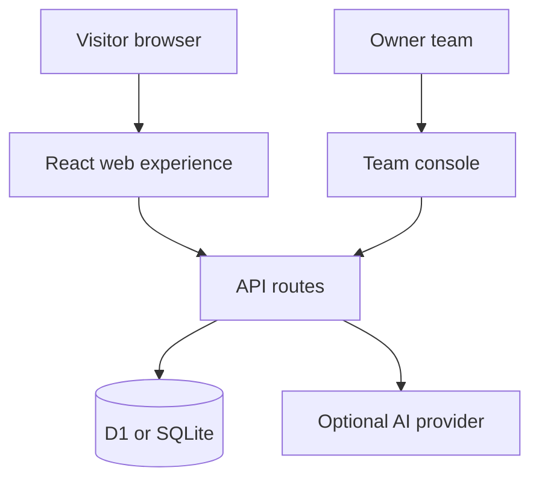

# Flowly Project Blueprint

**Prepared:** 27 October 2026  
**Scope:** Flowly bilingual AI, software and automation website, hosted preview and EC2 distribution.  
**Status key:** Implemented = present in the website or portable distribution; Planned = requires a real provider, legal review, commercial decision, or delivery engagement.

## Current architecture

The hosted version uses Vinext/D1. The EC2 distribution uses Vite, Node and SQLite behind Caddy or a reverse proxy. Shared API validation lives in `lib/api.ts`.
