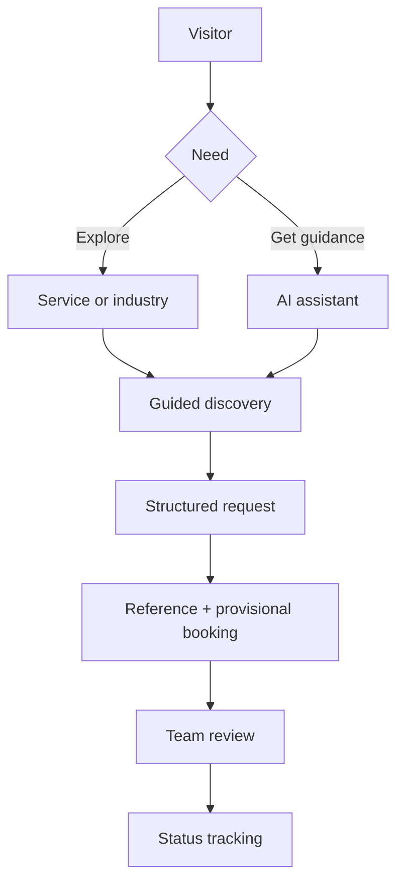

# Flowly Project Blueprint

**Prepared:** 27 October 2026  
**Scope:** Flowly bilingual AI, software and automation website, hosted preview and EC2 distribution.  
**Status key:** Implemented = present in the website or portable distribution; Planned = requires a real provider, legal review, commercial decision, or delivery engagement.

## Primary flow

Government visitors may enter through `/government` and carry institutional fields into intake.
